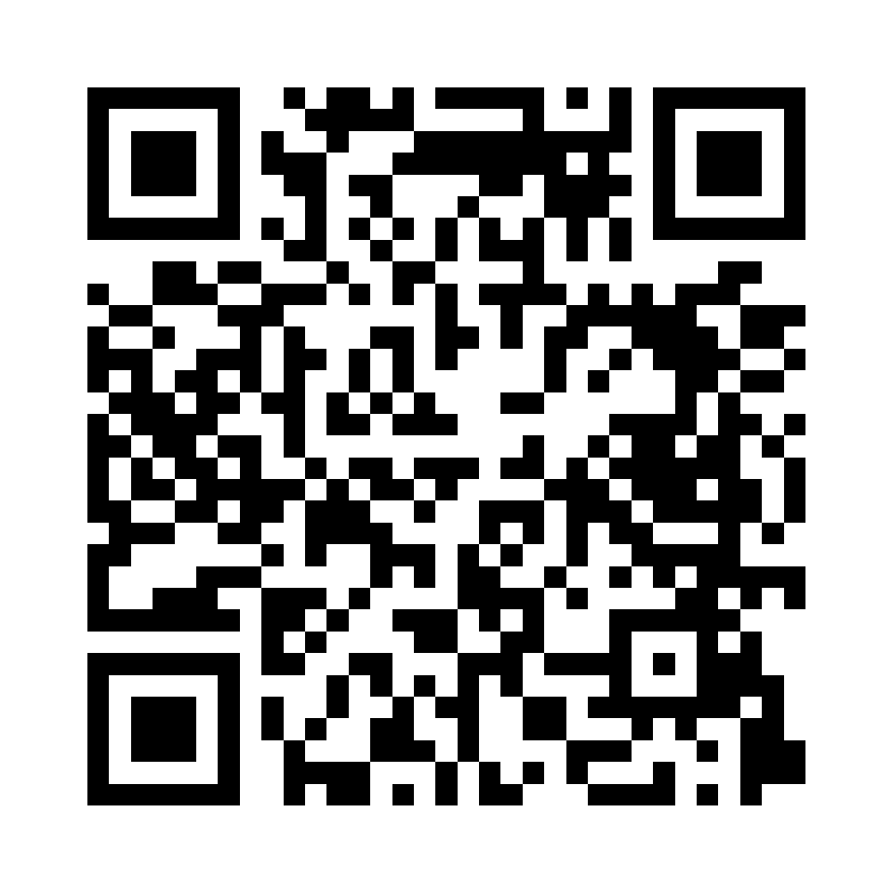

# DataSovereign

> **Reclaim Control. Monetize Ethically. Govern Autonomously.**

DataSovereign is a revolutionary platform for personal data ownership and monetization, designed to empower individuals with full sovereign control over their digital DNA while creating unprecedented value for all stakeholders in the data economy.

## 🌟 Overview

DataSovereign represents the next generation of data sovereignty technology, combining AI-powered dynamic pricing, quantum-resistant security, and user-centric design to create the world's first truly ethical data monetization platform. Built for the Impact10X innovation challenge, this MVP demonstrates how individuals can own, value, and profit from their personal data while maintaining complete control over privacy and sharing preferences.

## 🚀 Live Demo

**Experience DataSovereign:** [https://ulgwvahq.manus.space](https://ulgwvahq.manus.space)

Scan the QR code below to access the demo on your mobile device:



## 🎯 Core Features

### 📊 User Dashboard
- **Five Data Categories**: Identity, Health, Financial, Device, Location
- **Dynamic Value Display**: Real-time AI-generated pricing per data category
- **Sharing Controls**: Granular None → Partial → Full sharing toggles
- **Earnings Tracking**: Weekly earning projections and balance updates

### 🤖 AI-Powered Dynamic Pricing Engine
- **Market-Based Valuation**: Intelligent pricing based on demand, scarcity, and trends
- **Real-Time Updates**: Values fluctuate based on simulated market conditions
- **Transparency**: Clear explanations for pricing decisions and market trends
- **Optimization**: AI-suggested strategies for maximizing data value

### 🛡️ Quantum Security Layer
- **Always-Visible Protection**: Quantum-Safe Encryption Active badge
- **Future-Proof Security**: Designed for NIST-approved post-quantum cryptography
- **Visual Indicators**: Clear security status and protection levels
- **Educational Tooltips**: Information about quantum-resistant encryption

### ⚖️ Data Rights Center
- **Data Bill of Rights**: Comprehensive user rights and protections
- **Access Control**: Detailed view of who has access to what data
- **Recall Functionality**: One-click data recall and access revocation
- **Compliance Tracking**: Automated documentation for regulatory purposes

## 🏗️ Architecture

DataSovereign is built with a modern, scalable architecture designed for rapid deployment and future enhancement:

### Frontend
- **HTML5/CSS3/JavaScript**: Pure web technologies for maximum compatibility
- **Mobile-First Design**: Responsive interface optimized for all devices
- **Dark Mode Interface**: Futuristic aesthetic with soft-glass effects
- **Progressive Enhancement**: Works across all modern browsers

### Security Framework
- **Quantum-Resistant Design**: Prepared for post-quantum cryptography standards
- **Zero-Trust Architecture**: Every interaction verified and encrypted
- **Privacy by Design**: User data sovereignty built into every component
- **Compliance Ready**: GDPR, CCPA, and Australian Privacy Act compatible

### AI Engine
- **Dynamic Pricing Algorithm**: Rules-based engine with machine learning readiness
- **Market Simulation**: Real-time value fluctuations based on supply and demand
- **Trend Analysis**: Predictive modeling for data value optimization
- **Decision Transparency**: Explainable AI for all pricing and recommendation decisions

## 🛠️ Installation & Setup

### Quick Start
1. Clone this repository:
   ```bash
   git clone https://github.com/BIGfred-ai/datasovereign.git
   cd datasovereign
   ```

2. Open in your browser:
   ```bash
   # Simply open index.html in any modern web browser
   open index.html
   ```

3. For local development server:
   ```bash
   # Using Python
   python -m http.server 8000
   
   # Using Node.js
   npx serve .
   
   # Using PHP
   php -S localhost:8000
   ```

### Development Setup
For QR code generation (optional):
```bash
npm install
node generate-qrcodes.js
```

## 📱 Usage

### For Presentation (Impact10X)
1. **Print QR Codes**: Use the high-resolution QR codes in the `qr-codes/` directory
2. **Place on Tables**: Position QR codes for easy scanning by attendees
3. **Demo Flow**: Guide users through the key features:
   - Data category controls
   - Dynamic pricing visualization
   - Quantum security features
   - Data rights management

### For Development
1. **Customize Data Categories**: Modify the data categories in `app.js`
2. **Adjust Pricing Logic**: Update the AI pricing engine algorithms
3. **Enhance Security**: Integrate real quantum-resistant cryptography
4. **Add Features**: Extend functionality based on user feedback

## 🎨 Design Philosophy

DataSovereign follows a user-centric design philosophy that prioritizes:

- **Empowerment**: Users feel in control of their digital identity
- **Transparency**: All processes are clear and explainable
- **Security**: Quantum-resistant protection is always visible
- **Simplicity**: Complex technology presented through intuitive interfaces
- **Trust**: Every interaction builds confidence in the platform

## 🔮 Future Roadmap

### Phase 1: Foundation (Current)
- ✅ Core MVP with essential features
- ✅ Quantum security visualization
- ✅ AI pricing engine simulation
- ✅ Mobile-responsive design

### Phase 2: Enhancement
- 🔄 Real quantum cryptography integration
- 🔄 Blockchain-based transaction ledger
- 🔄 Advanced AI decision transparency
- 🔄 Multi-language support

### Phase 3: Ecosystem
- 📋 Corporate buyer marketplace
- 📋 Regulatory compliance automation
- 📋 Cross-platform data synchronization
- 📋 API for third-party integrations

### Phase 4: Scale
- 📋 Global deployment infrastructure
- 📋 Advanced analytics and insights
- 📋 Machine learning optimization
- 📋 Enterprise solutions

## 🤝 Contributing

We welcome contributions from developers, designers, privacy advocates, and data sovereignty enthusiasts. Please read our [Contributing Guidelines](CONTRIBUTING.md) before submitting pull requests.

### Development Guidelines
- Follow the existing code style and structure
- Ensure mobile-first responsive design
- Maintain quantum security visualization
- Test across multiple browsers and devices
- Document all new features and changes

## 📄 License

This project is licensed under the MIT License - see the [LICENSE](LICENSE) file for details.

## 🏆 Impact10X Innovation Challenge

DataSovereign was created for the Impact10X innovation challenge at James Cook University, demonstrating:

- **Bold Real-World Utility**: Solving the global data privacy and monetization crisis
- **Functional Interaction**: Fully working prototype with realistic user flows
- **Ethical Technology**: Privacy-first design with user empowerment at its core
- **Visionary Security**: Quantum-resistant protection for the post-quantum era
- **Future Scaling Potential**: Architecture designed for global deployment

## 📞 Contact

For questions, feedback, or collaboration opportunities:

- **Project Lead**: Freddie Beldam
- **Email**: freddie_1989@hotmail.com

## 🙏 Acknowledgments

- Impact10X Innovation Challenge organizers
- James Cook University innovation ecosystem
- Open source community for tools and inspiration
- Privacy advocates and data sovereignty researchers

---

**DataSovereign** - *Your data. Your rules. Your income.*

*Built in Australia. Quantum-secure. Globally scalable.*

